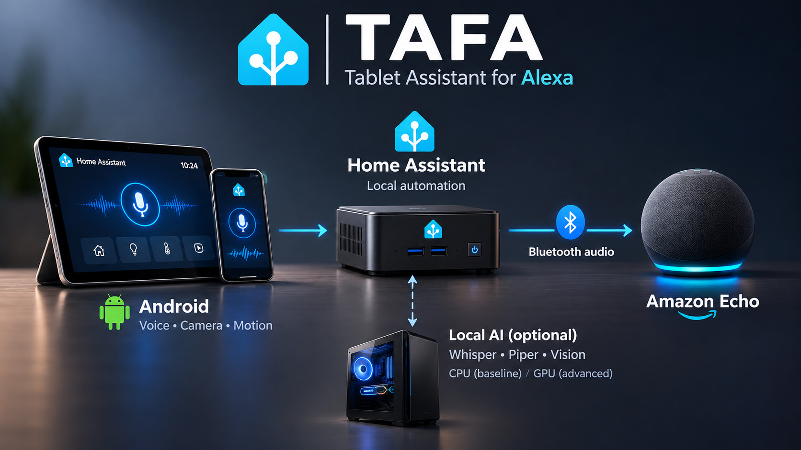

# TAFA · Tablet Assistant for Alexa



[English](README.md) | **Deutsch**

**Dein lokaler KI-Sprachassistent für Home Assistant – mit Android-Tablet und Echo-Lautsprecher.**

  

TAFA verbindet lokale Spracherkennung, Home-Assistant-Daten, optionale KI-Modelle und natürliche Sprachausgabe. Ein Android-Tablet dient als Mikrofon und Oberfläche; der Echo behält seine gewohnten Bluetooth- und Alexa-Funktionen.

## Funktionsübersicht

| Bereich | Funktionen |
|---|---|
| Sprache | Whisper STT, Rufwort, Gesprächsführung, Anschlussfragen |
| Audio | Piper als CPU-Basis, optional Qwen-Streaming, Echo Relay über Bluetooth |
| Haussteuerung | Lokale HA-Intents, Wetter, Energie, Heizung, Bring!, Abfall, Erinnerungen |
| KI | Optionales lokales Ollama-LLM, Modellwahl und Kontext-Einstellungen |
| Native Android-App | Echo Relay, Bluetooth-Streaming, Front-/Rückkamera, optionale Bildbewegungserkennung für HA |
| Vision | Lokale Einzelbildbeschreibung, Kameraansicht, optionale strukturierte Bewegungsauswertung |
| HA-Automationen | Wiederverwendbare Sprachausgabe mit Bestätigung, Wetterhinweise, Begrüßung, Testtimer |
| Familie | Drei optionale Namensfelder in HA-Helfern; keine Identitätserkennung |
| Durchsagen | Optionale Alexa-MP3-Durchsagen über temporäre HTTPS-Links |

**In der bestehenden privaten Hauszentrale getestet:** native Bluetooth-Sprachausgabe, HA-Sprechaktion, personalisierte Begrüßung und Testtimer. Die universelle Infobox ist dort eingerichtet; Ring-Ablauf und öffentliche neue Karte benötigen noch einen vollständigen End-to-End-Test.

> **Entwicklungsvorschau:** Basisintegration 0.3.1, Backend 1.7.0, GPU Worker 2.2.0 (aktualisiertes Schema), APK 0.6.0. Optionale Karte 1.3.0 und Automationsvorlagen sind noch kein vollständig geprüfter Neuinstallations-Release. Keine GPU für die CPU-Basis erforderlich.

## Neu: Native HA-Automationen

[Einrichtung der Automationsvorlagen und Familienfelder](docs/ha-automations.md). Das Dashboard bearbeitet die Namen, Home Assistant verwaltet Bedingungen, Wetter und Zeitfenster. Vision-Kategorien sind unsichere visuelle Schätzungen, keine Gesichtserkennung oder Identitätsfeststellung. Automatische Bildauswertung nur mit Zustimmung aller Betroffenen aktivieren.

## Architektur

Home Assistant ist die zentrale Steuerung. Das Android-Gerät übernimmt Spracheingabe, Kamera und Bluetooth-Audioausgabe über die native Echo Relay-App.

**Sprache:** Android-Mikrofon → Home Assistant Assist → Whisper (STT) → Gesprächsrouter → lokale HA-Intents oder LLM → Piper oder Qwen (TTS) → Echo Relay auf Android → Bluetooth → Amazon Echo.

**Kamera & Bewegung:** Android-Front-/Rückkamera → Home Assistant (Kamera-Entität und Bewegungssensor) → optionaler Vision-Worker → Bildbeschreibung oder HA-Erkennungsereignis.

**Automatisierungen:** HA-Ereignis → Bedingungen und Aktionen → optionale Sprachausgabe über Echo Relay.

Die CPU-Basis nutzt Whisper und Piper ohne separate Grafikkarte. Ein optionaler GPU-Worker erweitert sie um beschleunigtes STT, Qwen Streaming-TTS, lokale Ollama-Sprachmodelle und Vision. Alternativ sind Alexa-Durchsagen über eine MP3-API und einen HTTPS-Proxy möglich.

## Home Assistant Marketplace

[](https://my.home-assistant.io/redirect/hacs_repository/?owner=michaelbudisch&repository=tablet-assist-for-alexa&category=integration)

**Home Assistant 2026.11+:** Einstellungen → Marketplace → Über Link hinzufügen → `https://github.com/michaelbudisch/tablet-assist-for-alexa` → Integration. Anschließend Tablet Assist for Alexa über den Integrationsdialog konfigurieren. Die Sprachserver werden separat installiert. [Einrichtung](docs/marketplace.md). Englische Bedienoberfläche und Dokumentation sind enthalten; Sprachbefehle und Modelle der enthaltenen Pipeline sind weiterhin deutsch.

Die native Assist-Integration bündelt STT, TTS und Gesprächsrouter ohne manuelle YAML-Bearbeitung. Der optionale Nginx-Proxy stellt ausschließlich kurzlebige MP3-Dateien bereit. Timer und Benachrichtigungsmanager des bisherigen Dashboards bleiben als manuelle Vorlagen erhalten; sie werden nicht durch den Marketplace installiert. Entwickler-Vorschau: keine vollständige Neuinstallation bestätigt.

## Native Android-App: Audio, Kamera und Bewegung

**[HA Jarvis Echo Relay 0.6.0](android/README.de.md)** bietet einen deutschen/englischen Android-Player mit HA-Suche, einmaligem Token-QR-Scan, bestätigter Bluetooth-Ausgabe und optionalem nativem Silent-Keepalive. [Fertige Vorschau-APK](android/downloads/HA-Jarvis-Echo-Relay-0.6.0-preview.apk). Die eigenständige [Echo Relay Assist Lovelace-Karte](docs/echo-relay-dashboard.md) verbindet die App ohne Hauszentrale mit einem beliebigen HA-Dashboard. Die Befehls-/Statushelfer werden separat eingerichtet; die Marketplace-Integration tut dies nicht automatisch.

Die App ist nicht nur ein Audioplayer: Sie kann ein Android-Smartphone oder Tablet als zusätzliche Kamera für Home Assistant bereitstellen. Die vorhandene Front- oder Rückkamera liefert nach ausdrücklicher Freigabe regelmäßig aktualisierte Einzelbilder. HA erhält eine Kamera-Entität und optional einen Bildbewegungssensor. Der lokale Vision-Worker kann für freigegebene Sichtfragen und HA-Automationen eingesetzt werden. Die Kamera-Funktion ist unabhängig von der Audiowiedergabe und muss bewusst gestartet werden; sie startet nicht automatisch nach einem Geräte-Neustart. Die Bilder werden nicht archiviert. Es handelt sich um Einzelbilder, nicht um einen vollwertigen Video-Livestream. [Details zur Android-App](android/README.de.md#kamera-und-lokales-visionmodell).

## Multiroom · Backend 1.7.0

[**Vollständige Multiroom-Einrichtung mit TAFA-Kiosk-Audiofix**](homeassistant/examples/MULTIROOM.de.md) · [English](homeassistant/examples/MULTIROOM.md)

Ein Home Assistant für mehrere Tablets, je Raum eigenes Nicht-Admin-Konto, getrennte Echo-Relay-Ausgabe, optionale Kamera-/Bewegungsentitäten und einstellbare Bildrate. Raumverwaltung mit Zuordnung, Ruhezeiten und gezielten Durchsagen. Die Raumkarte benötigt dasselbe Konto in App und HA-Dashboard sowie vertrauenswürdiges HTTPS für das Mikrofon. Keine alten Audiohelfer im Raum-Modus nötig. Ein echtes Tablet und automatisierte Zwei-Raum-Tests bestanden; gleichzeitiger Hardwaretest mit zwei Tablets und Neuinstallation noch offen. Die Marketplace-Basisintegration installiert dieses separate Backend nicht automatisch.

## Lokales HTTPS für das Tablet-Mikrofon

Mit einem vorhandenen NGINX-/Certbot-Proxy ermöglicht [optionales Split-DNS](docs/local-https.md) den direkten LAN-Zugriff über **denselben gültigen HTTPS-Hostnamen**, auch ohne Internet. Kein zweiter Proxy, keine neuen Router-Ports und keine festen privaten IPs im TAFA-Dashboard. Bestehende öffentliche Seiten werden dadurch nicht automatisch gesperrt.

## Installation

```bash
git clone https://github.com/michaelbudisch/tablet-assist-for-alexa.git
cd tablet-assist-for-alexa
```

| Anleitung | Beschreibung |
|---|---|
| [CPU-Sprachserver / Proxmox](docs/proxmox.md) | Lokale Sprachdienste |
| [Marketplace und Konfiguration](docs/marketplace.md) | HA-Integration und Einrichtung |
| [Android-Tablet / Bluetooth](docs/home-assistant.md) | Manuelle Altinstallation |
| [Multiroom-Einrichtung](homeassistant/examples/MULTIROOM.de.md) | Raumkonten, Audio, Kamera, HTTPS und Fehlerbehebung |
| [Echo Relay Dashboard](docs/echo-relay-dashboard.md) | Lovelace-Installation |
| [HA-Automationen](docs/ha-automations.md) | Familienfelder und universelle Sprachausgabe |
| [Optionaler GPU-Rechner](docs/worker.md) | Windows/Linux, STT, TTS und lokale KI |
| [Optionaler Nginx-Proxy](docs/nginx-proxy.md) | DuckDNS und Certbot |
| [Lokales HTTPS / Split-DNS](docs/local-https.md) | Vorhandener NGINX, Tablet-Mikrofon und lokale Verbindung ohne Internet |
| [Lokale Datenquellen](docs/data-sources.md) | Sprachbefehle und unterstützte Entitäten |
| [Sicherheit und Datenschutz](docs/security.md) | Netzwerk- und Datenschutzgrenzen |
| [Tests und Release-Checkliste](docs/release.md) | Prüfstatus |
| [Versionshistorie](CHANGELOG.de.md) | Änderungsverlauf |

Die Skripte sind für **Neuinstallationen**, nicht für die Migration einer bestehenden Jarvis-Installation. Keine produktive Konfiguration überschreiben. Eigene Hosts, Gerätezuordnungen und Schlüssel ausschließlich lokal konfigurieren.

## Lizenz

MIT für eigenen Projektcode; siehe [LICENSE](LICENSE). Abhängigkeiten und Modelle werden separat bezogen und unterliegen ihren jeweiligen Lizenzen: [Piper](https://github.com/OHF-Voice/piper1-gpl), [Wyoming Faster Whisper](https://github.com/OHF-Voice/wyoming-faster-whisper), [Home Assistant](https://www.home-assistant.io/), [Faster Qwen3 TTS](https://github.com/andimarafioti/faster-qwen3-tts), [Qwen3-TTS](https://github.com/QwenLM/Qwen3-TTS), [FFmpeg](https://ffmpeg.org/), [Ollama](https://ollama.com/). Modelle und Stimmen sind nicht enthalten. Lizenzbedingungen und Modellkarten vor der Verwendung prüfen. Unabhängiges Community-Projekt; keine Verbindung zu oder Unterstützung durch Amazon. Alexa und Echo sind Marken ihrer jeweiligen Eigentümer.
