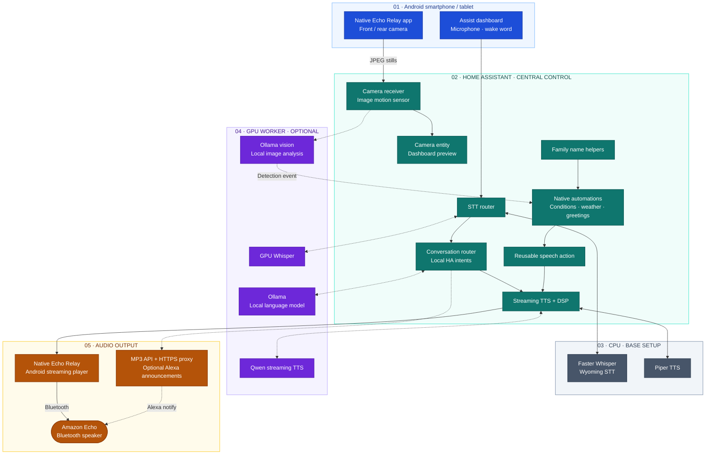

# Jarvis · Tablet Assist for Alexa

**English** · [Deutsch](README.de.md)

**Your local AI voice assistant for Home Assistant — powered by an Android tablet and an Echo speaker.**

  

Jarvis combines local speech recognition, Home Assistant data, optional AI models and natural speech. An Android tablet acts as the microphone and interface; the Echo retains its ordinary Bluetooth and Alexa functions.

## Features at a glance

| Area | Capabilities |
|---|---|
| Voice | Whisper STT, wake word, conversation, follow-up questions |
| Audio | CPU Piper, optional Qwen streaming, Echo Relay via Bluetooth |
| Home control | Native HA intents, weather, energy, heating, Bring!, waste collection, reminders |
| AI | Optional local Ollama LLM, model and context settings |
| Native Android app | Echo Relay, Bluetooth streaming, front/rear camera, optional image-motion detection for HA |
| Vision | Local still-image description, camera preview, optional structured motion detection |
| HA automations | Reusable speech action with acknowledgement, weather advice, greeting, test timer |
| Family | Three optional name helpers; no identity recognition |
| Announcements | Optional Alexa MP3 announcements via temporary HTTPS links |

**Tested in the existing private home dashboard:** native Bluetooth playback, HA speech action, personalized greeting and automatic test-timer cancellation. The generic infobox is installed there; the Ring workflow and standalone updated card still need end-to-end testing.

> **Developer preview:** base integration 0.3.1, backend 1.6.0, GPU Worker 1.9.0 (updated schema), APK 0.5.0. Optional card 1.3.0 and automation templates are not a fully verified fresh-install release. A GPU is not required for the CPU setup.

## New: native HA automations

[Set up automation templates and family settings](docs/ha-automations.md). The dashboard edits names while Home Assistant owns conditions, weather and time windows. Vision categories are fallible visual estimates, not facial or identity recognition. Enable automatic image analysis only with informed consent from affected people.

## Architecture


*Simplified system overview. Bluetooth audio is routed from the Android device to the Echo; CPU-based speech processing is part of the baseline setup.*

<details>
<summary>Detailed technical architecture</summary>



</details>

*Blue: Android devices · Teal: Home Assistant · Purple: optional AI · Grey: CPU baseline · Amber: audio output. Dashed arrows denote optional paths.*

## Home Assistant Marketplace

[](https://my.home-assistant.io/redirect/hacs_repository/?owner=michaelbudisch&repository=tablet-assist-for-alexa&category=integration)

Home Assistant 2026.11+: Settings → Marketplace → Add from link → `https://github.com/michaelbudisch/tablet-assist-for-alexa` → Integration. Configure Tablet Assist for Alexa in Devices & services. Speech servers are installed separately.

The Marketplace integration includes STT, TTS, conversation routing and the optional announcement action, without editing source files or YAML. Legacy control-panel, timer and automatic notification examples remain available under homeassistant/; Marketplace does not install them automatically.

After setup, a dedicated **Tablet Assist** sidebar panel is registered automatically, with native Assist launch, service status, optional Alexa announcements and Bluetooth keepalive. No legacy helper or private dashboard is required. Configuration and pipeline selection remain in Home Assistant.

## Native Android app: audio, camera and motion

**[HA Jarvis Echo Relay 0.5.0](android/README.md)** provides a German/English Android audio player with HA discovery, one-time token QR scanning, verified Bluetooth output and optional native silent keepalive. [Download the preview APK](android/downloads/HA-Jarvis-Echo-Relay-0.5.0-preview.apk). The standalone [Echo Relay Assist Lovelace card](docs/echo-relay-dashboard.md) connects the app to any HA dashboard. Set up the command/status helpers separately; the Marketplace integration does not configure them automatically.

The app is more than an audio player: it can expose the front or rear camera of an Android smartphone or tablet to Home Assistant. With explicit permission, the app supplies periodically refreshed still images; HA exposes a camera entity and an optional image-motion sensor. The local vision worker supports authorized camera questions and HA automations. Camera capture is independent of audio playback, must be explicitly started and does not automatically resume after device reboot. Images are not archived. These are refreshed stills, not a full-rate live video stream. [Android camera details](android/README.md#camera-and-local-vision).

## Installation guides

```bash
git clone https://github.com/michaelbudisch/tablet-assist-for-alexa.git
cd tablet-assist-for-alexa
```

| Guide | English | Deutsch |
|---|---|---|
| CPU speech server / Proxmox | [Read](docs/en/proxmox.md) | [Lesen](docs/proxmox.md) |
| Marketplace and configuration | [Read](docs/en/marketplace.md) | [Lesen](docs/marketplace.md) |
| Android tablet / Bluetooth / legacy setup | [Read](docs/en/home-assistant.md) | [Lesen](docs/home-assistant.md) |
| Optional GPU computer (Windows/Linux) | [Read](docs/en/worker.md) | [Lesen](docs/worker.md) |
| Optional Nginx proxy, DuckDNS and Certbot | [Read](docs/en/nginx-proxy.md) | [Lesen](docs/nginx-proxy.md) |
| Security / privacy | [Read](docs/en/security.md) | [Lesen](docs/security.md) |
| Tests and release checklist | [Read](docs/en/release.md) | [Lesen](docs/release.md) |
| Version history | [Changelog](CHANGELOG.md) | [Änderungen](CHANGELOG.de.md) |

Use installers for **new installations**; they do not migrate an existing Jarvis setup. Do not overwrite production configuration. Configure your own hosts, speaker entities and secrets locally. The Nginx installer also has a shared-proxy mode for a new unused hostname on an existing proxy.

## License

MIT for original project code; see [LICENSE](LICENSE). Dependencies and separately downloaded models remain subject to their own licenses: [Piper](https://github.com/OHF-Voice/piper1-gpl), [Wyoming Faster Whisper](https://github.com/OHF-Voice/wyoming-faster-whisper), [Home Assistant](https://www.home-assistant.io/), [Faster Qwen3 TTS](https://github.com/andimarafioti/faster-qwen3-tts), [Qwen3-TTS](https://github.com/QwenLM/Qwen3-TTS), [FFmpeg](https://ffmpeg.org/), [Ollama](https://ollama.com/). Models and voices are not bundled. Check model cards and license terms before use. Independent community project, not affiliated with or endorsed by Amazon. Alexa and Echo are trademarks of their respective owners.
