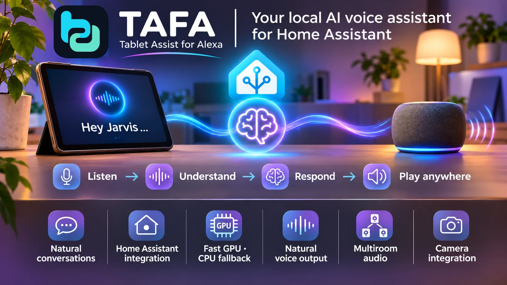
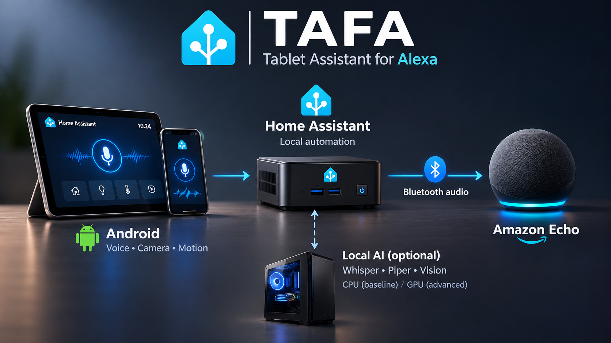

<p align="center">
  
</p>

<h1 align="center">TAFA — Tablet Assist for Alexa</h1>

<p align="center"><strong>A local voice assistant for Home Assistant, with an Android tablet as the microphone and an Echo as the Bluetooth speaker.</strong></p>

<p align="center"><strong>English</strong> · <a href="README.de.md">Deutsch</a></p>

TAFA brings together native Android voice input, Home Assistant, local speech recognition, optional AI models, and voice output. It is designed for everyday use without keeping a Home Assistant dashboard or the Companion app open. The Android **TAFA Device Bridge** handles wake-word detection and speech capture in the background; Home Assistant handles the request and sends the spoken response back to the tablet.



*Simplified architecture overview. The standard conversational audio path uses the Android device's Bluetooth connection to the Echo. Alexa announcements are a separate, optional path.*

## What TAFA does

| Area | Description |
| --- | --- |
| **Voice conversations** | Local wake-word detection on Android, audio sent to Home Assistant Assist, Whisper speech recognition, conversation handling and spoken replies. Optional follow-up questions. |
| **Local AI** | Use Home Assistant's own intents for smart-home commands and optionally connect an Ollama language model for open questions. |
| **Speech output** | Piper as a CPU option; optional GPU-based Qwen voice output. Replies play through the native Android player, including on a Bluetooth-connected Echo. |
| **GPU and CPU** | Route speech recognition to a separate GPU worker when available, with a separately configured CPU fallback. |
| **Multiroom** | Enrol multiple tablets, assign rooms, and manage native microphone and player status centrally in Home Assistant. |
| **TAFA Dashboard** | An integrated Home Assistant dashboard with configurable modules for lights, weather, energy, EV charging, heating, appliances, cameras and more. Data depends on your existing HA entities. |
| **Cameras and vision** | Optional Android camera bridge and local image analysis, enabled and configured separately. |
| **Announcements** | Optional proactive MP3 announcements through Alexa notification services. This is **not** the Bluetooth audio path used for normal conversations. |

TAFA is **not an Alexa replacement**: a paired Echo can still be used normally. For TAFA voice conversations it acts as a Bluetooth loudspeaker for the tablet; Alexa announcements are an independent integration.

## How it works

**The normal voice path**

```text
"Hey Jarvis" → TAFA Device Bridge (Android)
             → Home Assistant Assist / TAFA Lokal
             → Whisper STT (GPU or CPU)
             → HA intent or optional local Ollama model
             → Qwen / Piper TTS
             → TAFA Android audio player → Bluetooth → Echo
```

Wake-word detection runs on the tablet, not by repeatedly sending audio to Whisper. The native Android service remains independent of the open dashboard. A separate **Speak once** control in the TAFA Control Center is a browser-based diagnostic test, not a second permanent wake-word engine.

**Optional announcements:** home automation → generated MP3 → HTTPS/notification integration → Alexa. They are deliberately separate from conversational Bluetooth streaming.

## Project components

| Component | Role |
| --- | --- |
| **TAFA Home Assistant App** | Control Center, setup, service connections and optional bundled CPU speech services |
| **TAFA integration** | Assist STT/TTS/conversation routing, connected tablets, multiroom, dashboard and optional voice/vision interfaces |
| **TAFA Device Bridge** | Native Android background microphone, wake word, Assist WebSocket and Bluetooth audio playback |
| **Proxmox speech server** | Optional separate CPU Whisper/Piper services, MP3 generation and proxy |
| **GPU Worker** | Optional GPU Whisper, Ollama, Qwen streaming TTS and vision |

You can start with the CPU setup and add a GPU worker later. The services are designed to be selected in the TAFA Control Center; hardware, models, and other HA integrations are not assumed to be present.

## Get started

The **[step-by-step setup guide](docs/en/setup-guide.md)** covers installation choices and connecting the components. Installation commands and network configuration live in the dedicated guides rather than on this project overview.

[](https://my.home-assistant.io/redirect/supervisor_add_addon_repository/?repository_url=https%3A%2F%2Fgithub.com%2Fmichaelbudisch%2Ftablet-assist-for-alexa)

- [Home Assistant App installation](docs/en/app.md) · [Native Android app and compatible APKs](android/README.md)
- [CPU speech server on Proxmox](docs/en/proxmox.md) · [Optional GPU worker](docs/en/worker.md)
- [Multiroom setup](homeassistant/examples/MULTIROOM.md) · [Optional HA automations](docs/ha-automations.md)
- [Marketplace-only integration](docs/en/marketplace.md) — an alternative to the App-managed integration, **not an additional copy**
- [Security](docs/en/security.md) · [Release notes](CHANGELOG.md)

### Current development status

TAFA is an actively developed project. The integrated dashboard and native voice path are available in source, but new-device setup and physical audio behaviour should be verified on your hardware. **The Android source may be newer than the latest signed APK**: use a release signed with the *same certificate* as your installed Device Bridge for in-place updates; a CI debug APK is not a replacement for an existing release-signed app.

The opt-in native **Always on** mode is present in Device Bridge 1.2.1 source; it listens for speech activity without a wake word and can also react to background conversations. The familiar wake-word mode remains the default. See [Android releases and installation](android/README.md).

## Privacy and compatibility

Speech processing can stay on your own network. Device Bridge uses an explicit foreground microphone service; cameras and remote access require separate setup and permissions. Optional internet-facing Alexa MP3 delivery should be configured deliberately. TAFA does not distribute private dashboards, household-specific entity IDs or credentials. Existing HA automations are not automatically replaced or migrated.

This is an independent community project, not affiliated with Amazon or Home Assistant.

**License:** [MIT](LICENSE) for the project's original code. Third-party libraries and downloaded models have their own licenses.
