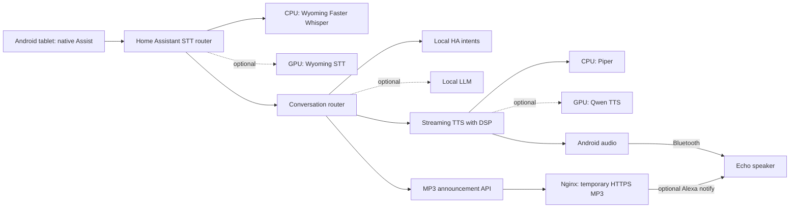

# Tablet Assist for Alexa — 0.3.1 (Developer Preview)

**English** | [Deutsch](README.de.md)

Local AI voice assistant for Home Assistant using an Android tablet as a microphone and an Amazon Echo as a Bluetooth speaker. No custom Echo firmware required. The Echo retains its normal Alexa functions; its internal assistant is not replaced.

The tablet runs native Assist, including supported Android wake word functionality. Whisper, Piper and optional Qwen TTS/LLM provide local speech processing. A GPU is not required for the CPU setup. Optional multiroom announcements use a compatible Alexa notify integration and temporary HTTPS MP3 links.

**Status:** Developer preview. The shipped speech pipeline, default models and custom voice-command grammar are German. The Marketplace interface, help and active installation documentation are available in German and English. End-to-end installation and device compatibility require testing. Start with a test instance.

**New in 0.3.1:** Local intent recognition, configurable weather, Bring!, collection, heating and energy sources, and a persistent reminder dialogue. [Data sources and voice commands](docs/en/data-sources.md).

**New:** Contextual follow-ups and optional administrator-approved aliases. [Guide](docs/en/data-sources.md).

## Architecture



## Home Assistant Marketplace

[](https://my.home-assistant.io/redirect/hacs_repository/?owner=michaelbudisch&repository=tablet-assist-for-alexa&category=integration)

Home Assistant 2026.11+: Settings → Marketplace → Add from link → `https://github.com/michaelbudisch/tablet-assist-for-alexa` → Integration. Configure Tablet Assist for Alexa in Devices & services. Speech servers are installed separately.

The Marketplace integration includes STT, TTS, conversation routing and the optional announcement action, without editing source files or YAML. Legacy control-panel, timer and automatic notification examples remain available under homeassistant/; Marketplace does not install them automatically.

After setup, a dedicated **Tablet Assist** sidebar panel is registered automatically, with native Assist launch, service status, optional Alexa announcements and Bluetooth keepalive. No legacy helper or private dashboard is required. Configuration and pipeline selection remain in Home Assistant.

## Installation guides

```bash
git clone https://github.com/michaelbudisch/tablet-assist-for-alexa.git
cd tablet-assist-for-alexa
```

| Guide | English | Deutsch |
|---|---|---|
| CPU speech server / Proxmox | [Read](docs/en/proxmox.md) | [Lesen](docs/proxmox.md) |
| Marketplace and configuration | [Read](docs/en/marketplace.md) | [Lesen](docs/marketplace.md) |
| Android tablet / Bluetooth / legacy setup | [Read](docs/en/home-assistant.md) | [Lesen](docs/home-assistant.md) |
| Optional GPU computer (Windows/Linux) | [Read](docs/en/worker.md) | [Lesen](docs/worker.md) |
| Optional Nginx proxy, DuckDNS and Certbot | [Read](docs/en/nginx-proxy.md) | [Lesen](docs/nginx-proxy.md) |
| Security / privacy | [Read](docs/en/security.md) | [Lesen](docs/security.md) |
| Tests and release checklist | [Read](docs/en/release.md) | [Lesen](docs/release.md) |
| Version history | [Changelog](CHANGELOG.md) | [Änderungen](CHANGELOG.de.md) |

Use installers for **new installations**; they do not migrate an existing Jarvis setup. Do not overwrite production configuration. Configure your own hosts, speaker entities and secrets locally. The Nginx installer also has a shared-proxy mode for a new unused hostname on an existing proxy.

## License

MIT for original project code; see [LICENSE](LICENSE). Dependencies and separately downloaded models remain subject to their own licenses: [Piper](https://github.com/OHF-Voice/piper1-gpl), [Wyoming Faster Whisper](https://github.com/OHF-Voice/wyoming-faster-whisper), [Home Assistant](https://www.home-assistant.io/), [Faster Qwen3 TTS](https://github.com/andimarafioti/faster-qwen3-tts), [Qwen3-TTS](https://github.com/QwenLM/Qwen3-TTS), [FFmpeg](https://ffmpeg.org/), [Ollama](https://ollama.com/). Models and voices are not bundled. Check model cards and license terms before use. Independent community project, not affiliated with or endorsed by Amazon. Alexa and Echo are trademarks of their respective owners.
