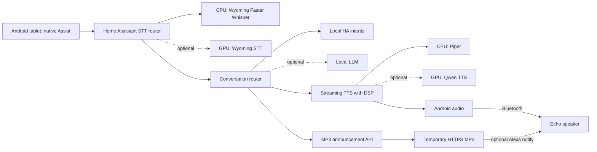

# Tablet Assist for Alexa — 0.2.1 (Developer Preview)

Local AI voice assistant for Home Assistant using an Android tablet as the microphone and an Amazon Echo as a Bluetooth speaker. No custom Echo firmware is required. Ordinary Alexa functions remain independent; Alexa is not replaced internally.

**Deutsch:** Ein Android-Tablet übernimmt Mikrofon, Wakeword und native Home-Assistant-Assist-Pipeline. Die Antwort wird über den Bluetooth-Lautsprecher (z. B. Amazon Echo) ausgegeben. Separat können Echo-Geräte über eine kompatible Alexa-Integration MP3-Durchsagen empfangen. Lokale Sprachverarbeitung mit Whisper, Piper und optional Qwen-TTS/LLM; eine GPU ist nicht zwingend notwendig.

**Status:** v0.2.1, öffentliche Entwicklungsvorschau. Native Tablet-Ausgabe, Live-Klangprofile, Gesprächsrouter, Timer/Erinnerung, automatische Hinweise und Original-GPU-Worker 1.5.0. Keine vollständig auf einer frischen Installation verifizierte Version. Die native Android-/Echo-Kompatibilität ist geräteabhängig. Start mit einer Testinstanz empfohlen.

## Architektur



## Home Assistant Marketplace

[](https://my.home-assistant.io/redirect/hacs_repository/?owner=michaelbudisch&repository=tablet-assist-for-alexa&category=integration)

**Home Assistant 2026.11+:** Einstellungen → Marketplace → Über Link hinzufügen → `https://github.com/michaelbudisch/tablet-assist-for-alexa` → Integration. Anschließend Tablet Assist for Alexa über den Integrationsdialog konfigurieren. Die Sprachserver werden separat installiert. [Setup DE/EN](docs/marketplace.md).

Die native Assist-Integration bündelt STT, TTS und Gesprächsrouter ohne manuelle YAML-Bearbeitung. Der optionale Nginx-Proxy stellt ausschließlich kurzlebige MP3-Dateien bereit. Timer und Benachrichtigungsmanager des bisherigen Dashboards bleiben als manuelle Vorlagen erhalten; sie werden nicht durch den Marketplace installiert. Entwickler-Vorschau: keine vollständige Neuinstallation bestätigt.

## Installation

```bash
git clone https://github.com/michaelbudisch/tablet-assist-for-alexa.git
cd tablet-assist-for-alexa
```

1. [Proxmox / Debian Sprachserver](docs/proxmox.md) — CPU-Basis und optionale LXC-Erstellung.
2. [Marketplace-Installation](docs/marketplace.md) — neue Integration empfohlen; oder [manuelle Legacy-Installation](docs/home-assistant.md) — Integrationen, Pipeline, Dashboard, Tablet-/Echo-Kopplung.
3. [Optional: Windows oder Linux KI-Rechner](docs/worker.md) — Faster Whisper, Qwen-TTS, Streaming, Ollama.
4. [Optionaler Nginx-Proxy-CT](docs/nginx-proxy.md) — nur für Alexa-MP3-Durchsagen; DuckDNS-App, Certbot und vorhandene Nginx-Proxy-CTs werden beschrieben.
5. [Sicherheit und Datenschutz](docs/security.md) — LAN-Zugriff, Bluetooth und Alexa-Ausgabe.
6. [Tests und Releasehinweise](docs/release.md).

Die Skripte sind für **Neuinstallationen**, nicht für die Migration einer bestehenden Jarvis-Installation. Keine produktive Konfiguration überschreiben. Eigene Hosts, Gerätezuordnungen und Schlüssel ausschließlich lokal konfigurieren.

## Lizenz / License

MIT für eigenen Projektcode; siehe [LICENSE](LICENSE). Abhängigkeiten und Modelle werden separat bezogen und unterliegen ihren jeweiligen Lizenzen: [Piper](https://github.com/OHF-Voice/piper1-gpl), [Wyoming Faster Whisper](https://github.com/OHF-Voice/wyoming-faster-whisper), [Home Assistant](https://www.home-assistant.io/), [Faster Qwen3 TTS](https://github.com/andimarafioti/faster-qwen3-tts), [Qwen3-TTS](https://github.com/QwenLM/Qwen3-TTS), [FFmpeg](https://ffmpeg.org/), [Ollama](https://ollama.com/). Modelle und Stimmen sind nicht enthalten. Lizenzbedingungen und Modellkarten vor der Verwendung prüfen. Unabhängiges Community-Projekt; keine Verbindung zu oder Unterstützung durch Amazon. Alexa und Echo sind Marken ihrer jeweiligen Eigentümer.
