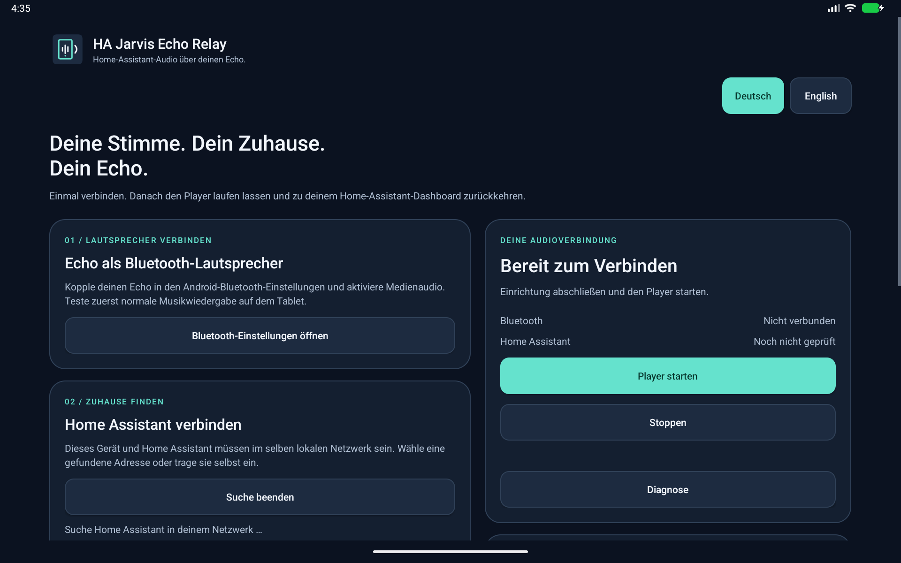

# HA Jarvis Echo Relay · Android 0.2.0

[English](README.md) | **Deutsch**

Native Audiobrücke von Home Assistant über ein Android-Gerät zu einem Bluetooth-Lautsprecher, zum Beispiel einem Amazon Echo. Android 9 oder neuer. Kein Mikrofonzugriff, kein Wakeword und kein automatischer Start nach dem Booten.



## Download und Update

[Fertige Vorschau-APK herunterladen](downloads/HA-Jarvis-Echo-Relay-0.2.0-preview.apk). Die SHA-256-Prüfsumme steht in [downloads/SHA256SUMS](downloads/SHA256SUMS).

Die APK **über die vorhandene Version installieren**. App-ID `de.jarvis.audio`, Schlüsselalias und bisheriges Speicherformat bleiben erhalten. Adresse und verschlüsselter Token bleiben dadurch auf demselben Gerät erhalten. Der sichtbare Name und das Icon ändern sich.

Die Vorschau verwendet denselben lokalen Android-Testsignaturschlüssel wie die vorherigen Builds, damit Updates funktionieren. Die veröffentlichte APK ist ein signierter, nicht debuggbarer Release-Build; Signaturschlüssel werden nicht veröffentlicht. CI-Debug-APKs verwenden einen anderen Testschlüssel und sind kein Ersatz für dieses Update.

## Einrichten

1. **Echo verbinden.** In den Android-Bluetooth-Einstellungen koppeln und als Medienaudio-Ausgang auswählen. Zuerst normale Musikwiedergabe auf dem Tablet testen.
2. **Home Assistant auswählen.** Die App sucht bei leerem Adressfeld automatisch im lokalen Netzwerk. Tablet und HA müssen im selben Netzwerk sein; Gäste-WLAN oder getrennte VLANs können die Suche blockieren. Alternativ die Basisadresse ohne `/lovelace` oder andere Pfade eingeben.
3. **Token direkt aus Home Assistant scannen.** In HA das Profil öffnen → **Sicherheit → Langlebige Zugriffstoken → Token erstellen**. Einen Namen vergeben und im Erstellungsdialog **QR-Code generieren** wählen. In der App **Token-QR-Code scannen** antippen. Der Token und sein QR-Code werden nur beim Erstellen angezeigt. Vor dem Schließen scannen; bei geschlossenem Dialog gegebenenfalls einen neuen Token erstellen. Ein externer QR-Generator ist nicht erforderlich. Manuelles Einfügen bleibt möglich.
4. **Player starten.** Benachrichtigungen erlauben. Der Token wird verschlüsselt gespeichert. Im bereits kompatiblen HA-Dashboard **Native Audio App (Beta)** als Ausgabe auswählen und eine kurze Antwort testen. Die App-Benachrichtigung aktiv lassen.

Die Oberfläche folgt zunächst der Gerätesprache und lässt sich oben zwischen **Deutsch** und **English** umschalten. Nicht gespeicherte Token bleiben bei diesem Sprachwechsel ausschließlich im Arbeitsspeicher; sie werden nicht im Android-Instanzzustand abgelegt.

### Lokales HTTP

HTTPS prüft weiterhin das Serverzertifikat. HTTP muss für die konkrete lokale IP-Adresse samt Port ausdrücklich freigegeben werden. Dann werden Token und Audio im lokalen Netzwerk unverschlüsselt übertragen. Ein Adresswechsel setzt die Freigabe zurück. Öffentliches HTTP und HTTP über DNS-Namen sind nicht erlaubt; für lokale IP-Adressen die Netzwerksuche verwenden. Weiterleitungen werden nicht automatisch verfolgt.

### Bluetooth wach halten

Der **optionale native Keepalive ist standardmäßig ausgeschaltet**. Bei aktiviertem Schalter und laufendem Player spielt er einen lokalen, vollständig lautlosen PCM-Loop ab. Er kann unabhängig vom geöffneten HA-Dashboard laufen. **Player stoppen** oder die Benachrichtigungsaktion beendet ihn.

Damit können Ruhepausen und die erneute Echo-Ansage „Audio wird über … abgespielt“ reduziert werden. Die Ansage kommt vom Echo; ihre Unterdrückung ist nicht garantiert. Der Loop fordert keinen exklusiven Audiofokus an und verändert weder Systemlautstärke noch Bluetooth-Kopplung. Er wartet bei fehlendem Bluetooth, stoppt bei falscher Route und pausiert nach Fehlern; zum erneuten Versuch den Player neu starten oder die Option aus- und einschalten. Bei Audiofokusverlust während einer Sprachantwort pausiert auch der Keepalive.

**Nur einen Keepalive verwenden:** entweder diesen oder den HA-Dashboard-Keepalive. Normale Alexa-Musik, Telefonie, Akkuverbrauch und lange Ruhezeiten auf dem Zielgerät testen. Bei Störungen ausschalten. Für Dauerbetrieb die Stromversorgung und gegebenenfalls Androids Akku-Einstellungen prüfen. Ein Reboot startet den Player nicht automatisch.

## Benötigte HA-Anbindung

Dies ist eine optionale Audiobrücke für den bestehenden nativen Audiovertrag. Sie ersetzt die Companion App nicht und richtet keine HA-Pipeline ein. Die öffentliche Marketplace-Integration konfiguriert diesen Helfer-Transport nicht automatisch; ein kompatibler Controller bzw. ein entsprechend vorbereitetes Dashboard wird benötigt.

- `input_text.jarvis_native_audio_command`: JSON `{id,path,ts}` oder `{id,stop:true,ts}`. `id`: 1–40 Buchstaben/Ziffern/Bindestriche; `ts`: Unixzeit in Millisekunden. Nur `/api/tts_proxy/…` auf demselben HA-Server; Befehle älter als 15 Sekunden und der beim Player-Start vorhandene Befehl werden ignoriert.
- `input_text.jarvis_native_audio_status`: `ready|timestamp`, `no_bluetooth|timestamp` oder `id|buffering`, `id|playing|bluetooth`, `id|done`, `id|error_…`.
- Beide Helfer benötigen bis zu 255 Zeichen und passende Benutzerrechte. Token gehören nicht in Helfer, Protokolle oder Git.
- Die Datei wird zunächst vollständig gepuffert (maximal 24 MiB), app-lokal gespeichert und danach gelöscht. Diese Version streamt keine Audiodateien.
- Wiedergabe bleibt stumm, bis die tatsächliche A2DP-Route bestätigt ist. Änderungen während hörbarer Wiedergabe werden regelmäßig geprüft; eine Betriebssystem-Umschaltung kann nicht in jedem Fall ohne Verzögerung erkannt werden.

## Bauen und Prüfen

JDK 17, Android SDK Platform 35 und Build Tools 34.0.0 installieren. Im Android-Unterverzeichnis:

```powershell
./build.ps1 -Check
./build.ps1 -Configuration Release -Check
```

Linux/macOS: `./gradlew :app:assembleDebug :app:testDebugUnitTest :app:lintDebug :app:assembleDebugAndroidTest --no-problems-report` mit JDK 17. Der Release-Build ist zunächst unsigniert; privat mit dem vorgesehenen Update-Schlüssel signieren. Keine Keystores einchecken.

`UiSmokeInstrumentation` prüft im getrennten Emulator DE/EN, Telefon-/Tablet-Layout, HTTP-Freigabe, Eingaben beim Sprachwechsel, WAV-Dekodierung und Keepalive ohne Bluetooth. Kamera, Echo-Routing und die Wirkung nach langer Ruhezeit erfordern echte Hardwaretests.

## Lizenz

Eigener Code und Vektor-Icon: MIT wie das Hauptprojekt. ZXing Android Embedded, ZXing Core und AndroidX: Apache 2.0; siehe [THIRD_PARTY_NOTICES.md](THIRD_PARTY_NOTICES.md). Unabhängiges Community-Projekt, keine offizielle App von Home Assistant oder Amazon.
