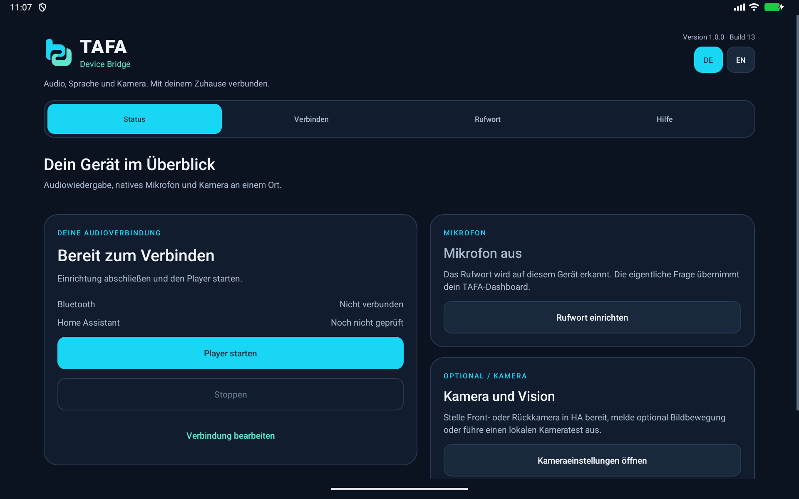

# TAFA Device Bridge · Android 1.0.1

**English** | [Deutsch](README.de.md) · [Project overview](../README.md)

The Android companion for TAFA: Home Assistant audio through Bluetooth, optional offline wakeword recognition and camera transmission. Android 9+.

## Download and update

[Download signed APK 1.0.1](downloads/TAFA-Device-Bridge-1.0.1.apk) · [GitHub release](https://github.com/michaelbudisch/tablet-assist-for-alexa/releases/tag/audio-v1.0.1) · [SHA-256 checksum](downloads/SHA256SUMS). Install over the existing signed app.

The original application ID de.jarvis.audio, certificate, encryption alias, preferences, downloaded model and persistent multiroom device ID are preserved. Android 1.0.1 uses version code **14**. Do not uninstall before updating. The Home Assistant backend continues using its existing Echo Relay / Jarvis Tablet Audio identifiers.

## Find your settings

- **Status:** audio connection, player controls, microphone state and camera shortcut.
- **Connect:** HA address, token QR scan, Bluetooth and room audio; keepalive is inside the expandable Bluetooth options.
- **Wakeword:** offline model, recognition controls, device/room name and expandable fine-tuning.
- **Help:** setup tips, background operation, diagnostics and credential removal.

Choose German or English in the header. Section changes retain unsaved input; a language change retains an unsaved token in memory only.

## Setup

1. Open **Connect**. Keep Android and HA on the same network. Select a discovered server or enter its base URL without /lovelace or dashboard paths.
2. In HA, open **Profile → Security → Long-lived access tokens → Create token**. Name it **TAFA Device Bridge**, choose **Generate QR code** and scan it with the app. HA displays the token and QR code only once; scan before closing. Manual pasting is also available.
3. Pair the Echo or Bluetooth speaker in Android, enable media audio and test normal playback.
4. Press **Save & start player**. Allow notifications and keep the service notification active.
5. Return to the compatible TAFA / Echo Relay dashboard for voice requests. The APK does not configure HA automatically.

HTTPS validates the server certificate. Local HTTP needs explicit permission for the precise local IP and port; token, audio and enabled camera images then travel unencrypted on the LAN. Changing the address resets permission.

## Optional voice and dynamic multiroom

Open **Wakeword**, explicitly download the approximately 45 MB German Vosk model and allow microphone access when starting recognition. Choose Hey Jarvis, Jarvis, Alexa or all three. The notification offers Stop. Recognition audio stays local; only a wakeword event is sent to HA.

The dynamic API from 0.9.0 is preserved: each installation has a persistent random ID. Enter a room name, start recognition, then select/pair the device in TAFA under **Voice & Audio**. There are no fixed numbered slots. Matching HA integration and TAFA dashboard are required separately.

Fine-tuning controls confirmations (1–3), cooldown (3–30 s) and microphone handoff (10–90 s). Settings and mute synchronize per device with HA; lost HA settings connectivity releases the recorder. No dB threshold is provided.

Keep the compatible dashboard open for Whisper STT and turn off its competing wakeword detector. Words immediately after the wakeword can be lost during handoff. Alexa may also trigger a physical Echo. Fully hands-free operation with a closed dashboard is not guaranteed.

## Experimental native spoken questions (1.0.1, opt-in)

The existing **wakeword-only mode remains the default**. If you want to try native voice conversations:

1. Under **Connect**, enable Multiroom audio and connect the existing non-admin tablet user. Start the audio player. Under **TAFA → Devices** in Home Assistant, assign this tablet to the same user's audio room, and confirm a successful **Test speech output**.
2. Under **Wakeword**, install the offline Vosk model and start native wakeword detection (microphone permission required).
3. Enable **After wakeword, listen for a full question** in the new **Native voice conversation** section. Optionally enable up to two follow-up questions and adjust the end-of-speech pause (900–3200 ms; default 1700 ms).
4. Tap **Test native question without wakeword** to test microphone → Assist → reply, then try **Hey Jarvis** followed by a short pause and a spoken question. Playback continues through the existing Android/Bluetooth player. The app chooses an available complete **TAFA Lokal** Assist pipeline, or another configured STT+TTS pipeline.

Audio is sent as 16 kHz PCM over the authenticated Home Assistant WebSocket **only for the question after a detected wakeword/manual test**. The microphone is released before the answer plays; no recording is saved by the app. An explicitly enabled follow-up window may reopen the mic after playback (at most twice), and times out on silence. Remote mute and Stop close active streaming. On the original disabled setting, only the matched wakeword event is forwarded, exactly as before. A compatible browser dashboard is **not needed** for the native mode. Local HTTP still exposes voice and credentials on your LAN; choose trusted HTTPS when possible.

**Release status:** This feature is source/CI validation only until a signed Android 1.0.1 APK is built with the **original signing key** and tested on hardware. Android 1.0.1 keeps application ID \`de.jarvis.audio\` and increases versionCode to 14. An unsigned release or GitHub CI debug APK **cannot be installed over the currently signed app**. Do not uninstall your current app or replace its stored token to test this feature. Use \`build.ps1 -Configuration Release -Check\` and privately sign using \`sign-release.ps1\` with the original keystore before distribution.

## Camera and Bluetooth keepalive

Open the camera from **Status**. Selection, HA relay and local preview have separate cards. Leaving preview clears local images; an explicitly started foreground camera relay can continue until stopped. Permissions are requested when required. Image intervals 1/2/3/5/10 seconds and optional motion detection remain available.

Keepalive defaults off. Its silent loop while the player runs may reduce Echo idle announcements, but can affect Alexa music and battery use. Use one keepalive source at a time. Nothing starts automatically after reboot.

## Build and signing

Use JDK 17, Android Platform 35 and Build Tools 36.0.0. Run build.ps1 -Configuration Release -Check, then sign-release.ps1 with -KeystorePath and -Alias. The default output is **dist/TAFA-Device-Bridge-1.0.1.apk**. The script checks the original 0.7.1 certificate; no private signing keys are included.

Build, JVM tests, lint and phone/tablet UI instrumentation are validated locally. Physical Bluetooth and multi-device testing remain necessary. See [release notes](RELEASE_NOTES.md) and [third-party notices](THIRD_PARTY_NOTICES.md).

## Interface

[Phone](docs/tafa-device-bridge-phone.png) · [Camera](docs/tafa-device-bridge-camera.png)
