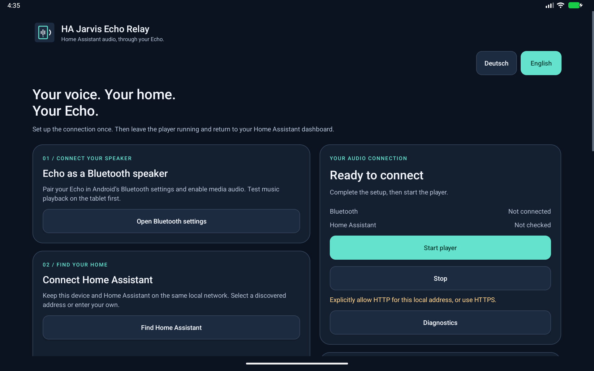

# HA Jarvis Echo Relay · Android 0.2.0

**English** | [Deutsch](README.de.md)

A native audio bridge from Home Assistant through an Android device to a Bluetooth speaker, including Amazon Echo. Android 9+. No microphone access, wake word or automatic startup after reboot.



## Download and update

[Download the ready-to-install preview APK](downloads/HA-Jarvis-Echo-Relay-0.2.0-preview.apk). Verify it with [downloads/SHA256SUMS](downloads/SHA256SUMS).

**Install over the existing app** to keep its address and encrypted token. The application ID `de.jarvis.audio`, encryption alias and preference format remain unchanged; only the visible app name and icon change.

The published, non-debuggable release APK uses the same local Android test signing key as earlier builds for update compatibility. Private signing keys are not included. CI debug APKs use a different temporary key and are not upgrade replacements for this download.

## Setup

1. **Connect the Echo.** Pair it in Android Bluetooth settings and enable media audio. Test ordinary music playback on the tablet first.
2. **Find Home Assistant.** Discovery starts automatically when the address is empty. Keep HA and the tablet on the same local network; guest Wi-Fi and VLAN isolation may block discovery. You can also enter the base URL without `/lovelace` or other paths.
3. **Scan the token directly from HA.** Open **Profile → Security → Long-lived access tokens → Create token**. Name it and select **Generate QR code** in the creation dialog. In this app, tap **Scan token QR code**. The token and QR code are shown only during creation: scan before closing the dialog, or create a new token if it is already closed. No external QR generator is needed. Manual paste is also available.
4. **Start the player.** Allow notifications so you can stop it from the notification shade. The token is stored encrypted. Return to your already compatible HA dashboard, select **Native Audio App (Beta)** as output and test a short answer.

The interface initially follows the device language. Use **Deutsch / English** at the top to switch it. Unsaved tokens survive a language switch in memory only, never in Android saved instance state.

### Local HTTP

HTTPS certificate validation remains enabled. HTTP requires explicit consent for the exact local IP address and port. Tokens and audio then travel unencrypted on the LAN. Editing the address resets consent. Public HTTP and HTTP DNS names are rejected; use discovery for a numeric LAN address. Redirects are never followed automatically.

### Native Bluetooth keepalive

**Off by default.** While the player is running, the optional keepalive plays a completely silent, locally bundled PCM loop independently of the HA page. Stopping the player or using its notification stop action also stops keepalive.

This may reduce idle gaps and Echo’s “Playing from…” prompts. The Echo generates those prompts, so suppression is not guaranteed. The loop does not request exclusive audio focus, change system volume or reconnect Bluetooth devices. It waits when Bluetooth is absent, stops on a wrong output route and pauses after errors; restart the player or toggle the option to retry. Audio focus loss during a spoken answer also pauses keepalive.

**Use one keepalive:** either this app or the HA dashboard loop. Test normal Alexa music, calls, long idle periods and battery usage on your actual device. Disable it if playback is affected. Continuous operation may require power and appropriate Android background/battery settings. Nothing starts automatically after reboot.

## Required Home Assistant connection

This optional bridge implements the existing native audio helper contract. It does not replace the Companion App or configure an Assist pipeline. The public Marketplace integration does not automatically provision this transport: a compatible dashboard/controller is required.

- `input_text.jarvis_native_audio_command`: JSON `{id,path,ts}` or `{id,stop:true,ts}`. IDs contain 1–40 letters/digits/hyphens; timestamps are Unix milliseconds. Only same-origin `/api/tts_proxy/…` paths are accepted. Commands older than 15 seconds and the command present at player startup are ignored.
- `input_text.jarvis_native_audio_status`: `ready|timestamp`, `no_bluetooth|timestamp`, or `id|buffering`, `id|playing|bluetooth`, `id|done`, `id|error_…`.
- Both helpers need up to 255 characters and appropriate HA user permissions. Never place tokens in helpers, logs or Git.
- Audio is buffered completely (maximum 24 MiB) in app-local storage, then deleted. This version does not stream the response file.
- Spoken audio remains muted until the actual A2DP output is confirmed. Output changes are checked periodically; system routing changes cannot always be detected without delay.

## Build and verification

Install JDK 17, Android SDK Platform 35 and Build Tools 34.0.0. From this Android directory:

```powershell
./build.ps1 -Check
./build.ps1 -Configuration Release -Check
```

Linux/macOS: `./gradlew :app:assembleDebug :app:testDebugUnitTest :app:lintDebug :app:assembleDebugAndroidTest --no-problems-report` with JDK 17. Release outputs are unsigned until you sign them privately with the intended update key. Do not commit keystores.

`UiSmokeInstrumentation` checks DE/EN, phone/tablet layouts, HTTP consent, token retention during language changes, bundled WAV decoding and keepalive cleanup without Bluetooth on an isolated emulator. Camera scanning, real Echo routing and idle prompt suppression require hardware tests.

## License

Original code and vector icon: repository MIT license. ZXing Android Embedded, ZXing Core and AndroidX: Apache 2.0. See [THIRD_PARTY_NOTICES.md](THIRD_PARTY_NOTICES.md). Independent community project, not an official Home Assistant or Amazon application.
