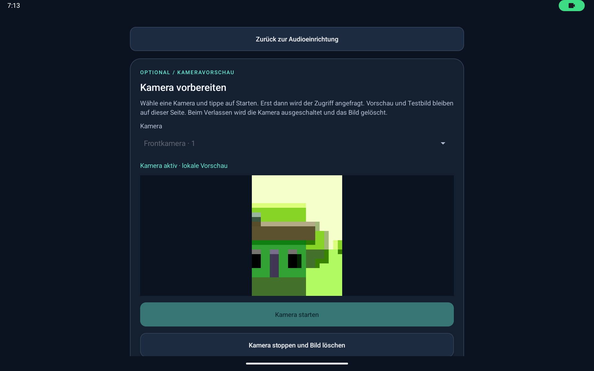

# Camera preparation · 0.4.0

The optional camera screen is a local test of the future image source. It does not yet expose a Home Assistant camera or contact a vision model.

## Implemented

- `CameraPreviewController`: Camera2 device/session lifecycle on a dedicated handler thread; local preview and on-demand JPEG callback. No dependency on audio service, HA credentials, storage or networking.
- `Lens`: camera ID and facing; default preference for front-facing hardware, with selection persisted separately from HA credentials.
- `Snapshot`: bounded JPEG bytes with camera-provided EXIF orientation and an app-receipt timestamp. Future transports must preserve/honor orientation and carry capture time; they must not treat an old image as live.
- `CameraActivity`: explicit permission/start, fit-and-mirror front preview, orientation-aware local JPEG display, clear and stop. Preview/JPEG surfaces are limited to 1280 × 960 pixels or a smaller supported size. Mirroring is for the front preview; the captured image retains the camera's original view for future OCR/vision.
- Stop, screen exit, screen-off and configuration recreation release camera resources and clear the visible in-memory image. Returning never restarts capture automatically. No recording or persistent image file is created.
- No camera foreground service is declared because there is no background capture in this release. Audio playback continues in its existing independent service.

## Proposed next steps — not implemented

Worker 1.6.0 now separately provides authenticated single-image `POST /describe` requests with base64 JPEG/PNG and a 2 MiB input limit. This app does not call it. The future HA adapter must enforce that smaller transport limit, honor JPEG orientation, carry freshness information separately, and use the worker's own credential. The local capture guard of 8 MiB is not a promise that every captured JPEG fits that API.

1. Choose authenticated local snapshot delivery: an opt-in LAN endpoint consumed by HA or an authenticated push receiver in a dedicated HA integration. Do not reuse the HA bearer token as a publicly exposed camera URL/credential. Define TLS/local transport consent separately.
2. Add HA `camera` integration/availability and fresh snapshot requests with timeout and timestamps, explicit start/stop, visible camera state and no stale-image substitution.
3. Add a separate user-started camera foreground service only if continuous operation is required, including notification Stop, OS permission/start restrictions, screen-off and device power testing. Keep it separate from the audio service.
4. Add on-demand vision requests for selected HA cameras. Existing outdoor camera snapshots can be used independently of this tablet camera.
5. Optionally add motion/event detection with rate limits; run semantic vision analysis on selected frames/events rather than every video frame.

## Validation

The Android camera instrumentation uses an isolated emulator with synthetic front/rear cameras. It checks the actual permission denial flow, explicit start, both preview sessions and JPEG capture, image bounds, clear/stop and background cleanup without automatic restart. It does not access a real camera, HA server or model. Hardware-specific image orientation, camera contention and long-running behavior still require target-device testing.
